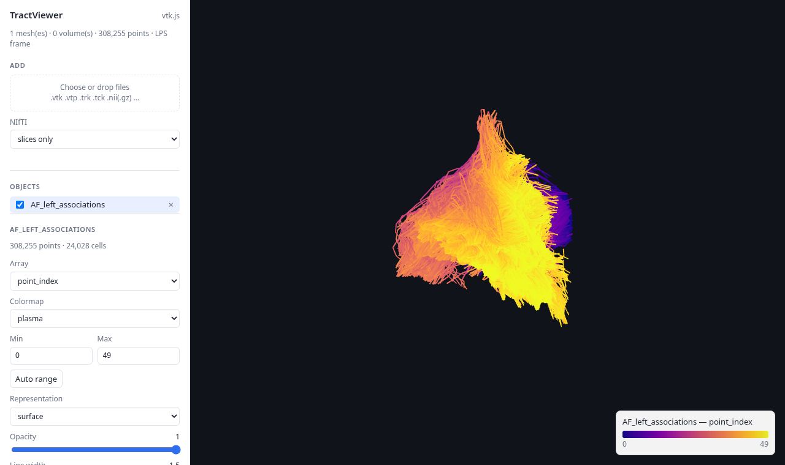

# TractViewer

Explore tractograms, surfaces and NIfTI volumes in your browser: color bundles by any of their
arrays, slice through anatomy, and export rotation GIFs, with nothing to install on the client side.
The same datasets can also be rendered headless (PNG, MP4, GIF) with pyvista.



Supported formats:
- tractography: `.tck`, `.trk`
- meshes: anything PyVista/VTK reads (`.vtk`, `.vtp`, ...)
- NIfTI: `.nii`, `.nii.gz`
- images: `.png`

## Quick start

```bash
pip install git+https://github.com/nathandecaux/TractViewer.git

tractviewer web --open                                # empty page, add files from the browser
tractviewer web anat.nii.gz bundle.trk --open         # start with some files
tractviewer html anat.nii.gz bundle.vtk -o scene.html # standalone page, no server needed
```

`tractviewer web` serves the interface on <http://127.0.0.1:8080>. `tractviewer html` writes a single
self-contained HTML file you can open locally or share.

## Web interface

Rendering happens in the browser (WebGL, [vtk.js](https://kitware.github.io/vtk-js/)). The geometry
and **all arrays** (point and cell data) are sent to the page, so exploring a bundle needs no round
trip to the server.

- **Objects**: pick the array to color by, the colormap, the range, a solid color, opacity, line
  width, representation; toggle visibility or remove an object. Vector arrays are colored by
  magnitude. Colormaps are sampled from matplotlib, so colors match the pyvista rendering.
- **Add files** (`web` only): use the button or drop files on the view; a loading indicator shows
  while the file is processed. Uploaded files go through the same loading as the CLI, including the
  projection of tractograms onto the affine of the first NIfTI.
- **Slices**: every NIfTI is also sent as a volume, resampled on the axes of the LPS/RAS frame.
  When a NIfTI is loaded it becomes the reference: sagittal, coronal and axial slices with
  colormap and windowing. Without a NIfTI, choose the reference (an object or the whole scene) and
  translucent cutting planes are drawn instead.
- **Isosurface**: NIfTI files are loaded as slices. Select a volume to generate its isosurface with
  marching cubes, choosing the iso value and the number of smoothing iterations (windowed sinc).
  It is computed in the browser, so it also works in exported pages. To compute it in Python
  instead, pass `marching_cubes=true` (and `smooth`, `iso`) in the file parameters.
- **Clipping**: cut the objects with the active planes, either as a slab of adjustable thickness
  or by keeping one side of each plane.
- **Rotation GIF**: full turn around the vertical axis of the current view, with frame count, FPS
  and width settings. Encoded in the browser, so it also works in pages exported with `html`.
- **View**: anatomical presets (left, right, anterior, posterior, superior, inferior), PNG capture,
  background color.

Large datasets: `--max-streamlines N` subsamples tractograms (fixed seed) and `--max-voxels N`
decimates volumes (default 16e6). A 3.6M-voxel volume adds about 20 MB to the page.

Notes:
- The page loads vtk.js (and the GIF encoder, on demand) from the jsdelivr CDN.
- Uploads have no authentication. The server listens on 127.0.0.1 by default; only use
  `--host 0.0.0.0` on a trusted network.

## Installation

```bash
pip install git+https://github.com/nathandecaux/TractViewer.git
```

Development:

```bash
git clone https://github.com/nathandecaux/TractViewer.git
cd TractViewer
pip install -e .
python -m pytest
```

## Command line

```text
tractviewer web        [FILES...]            web interface (upload, slices, GIF)
tractviewer html       FILES... -o x.html    standalone web page
tractviewer show       FILES...              desktop window (pyvista)
tractviewer screenshot FILES... -o x.png     PNG capture
tractviewer record     FILES... -o x.mp4     rotation video / GIF (format from the extension)
tractviewer info       FILES...              arrays and sizes of the datasets
```

### Headless rendering


```bash
tractviewer info bundle.vtk
tractviewer screenshot bundle.tck --background black -o out.png
tractviewer record bundle.tck --frames 180 -o rot.mp4
tractviewer record bundle.tck --frames 120 --fps 15 -o rot.gif
tractviewer show anat.nii.gz:cmap=gray,opacity=0.3 bundle.trk
```

### Per-file parameters

Syntax: `path:key=val,key=val`

```bash
tractviewer web \
  anat.nii.gz:display_array=intensity,cmap=gray,clim=(200,800),opacity=0.25 \
  bundle.tck:display_array=length_mm,cmap=plasma,line_width=2,threshold=(length_mm,50,200)
```

- bool: `true/false`, `yes/no`, `on/off`; a bare key means `true` (e.g. `contour`)
- `None`/`null`, `int`, `float`, tuples `(a,b,c)`
- `clim=(min,max)` or `clim=min:max`
- `threshold=(array,min,max)` or `threshold=array;min;max`
- cast of the displayed array: `type=int` or `type=float`

An unknown key triggers a warning suggesting the closest valid key.

### Common options

- `--background`, `--window-size WxH`, `--color` (default color), `--ras-axes`
- NIfTI: `--no-marching-cubes`, `--smooth N` (default 200), `--iso V`, `--coord LPS|RAS`
  (`web` and `html` always load NIfTI files as slices unless a file sets `marching_cubes=true`)
- `web`: `--host`, `--port`, `--open`, `--title`, `--max-streamlines`, `--max-voxels`
- `html`: `--title`, `--max-streamlines`, `--max-voxels`
- `screenshot` / `record`: `--mesh-rotation X Y Z` (default `-90 0 0`)
- `record`: `--frames`, `--step`, `--elevation`, `--fps`

## Python API

```python
from tractviewer import TractViewer

vis = TractViewer(background="black", off_screen=True, window_size=(1280, 720))
vis.add("anat.nii.gz", name="anat", display_array="intensity", cmap="gray",
        clim=(200, 800), opacity=0.2, iso=0.5)  # marching_cubes=False: slices only
vis.add("bundle.tck", name="bundle", display_array="length_mm", cmap="viridis",
        line_width=2, threshold=("length_mm", (50, 200)))

vis.serve(open_browser=True)                       # web interface
vis.export_html("bundle.html")                     # standalone web page

print(vis.list_arrays())
vis.edit("bundle", cmap="plasma")
vis.screenshot("capture.png")                      # mesh_rotation=(-90, 0, 0) by default
vis.record("rotation.mp4", n_frames=180, fps=30)   # .gif => GIF
vis.remove("anat")
```

Parameters can be passed as kwargs or as a dict (`vis.add(path, {"cmap": "gray"})`).

### `add(...)` parameters

- `display_array`, `cmap`, `clim`, `color`, `opacity`, `visible`, `name`
- `threshold=(array, (min, max))`
- `style`: `surface`, `wireframe`, `points`, `envelope`
- `points_as_spheres`, `point_size`, `line_width`
- `ambient`, `diffuse`, `specular`
- `contour` (`True` or a color) and `contour_width`
- `categorical_legend`, `categorical_max_values`, `unique_values`
- `scalar_bar` (alias `show_scalar_bar`), `scalar_bar_args`, `legend`
- `envelope_voxel_size`, `envelope_smooth`
- NIfTI loading: `marching_cubes`, `smooth`, `iso`

### Constructor

`TractViewer(background="white", off_screen=False, window_size=None, show_ras_axes=False,
coord_system=None, iso_value=None)`

### Methods

- `add(...)`, `edit(name, ...)`, `remove(name)`
- `serve(host, port, open_browser)`, `export_html(path)`
- `show()`, `screenshot(...)`, `record(...)`
- `names()`, `get_params(name)`, `get_dataset(name)`, `list_arrays()`
- `TractViewer.from_paths(...)`

### Deprecations

Still working, with a `TractViewerDeprecationWarning`:

| Old | New |
| --- | --- |
| `rm(name)` | `remove(name)` |
| `capture_screenshot(path, rotation_x=..)` | `screenshot(path, mesh_rotation=(x, y, z))` |
| `record_rotation(path, gif=.., rotation_x=..)` | `record(path, mesh_rotation=(x, y, z))` |
| `style="enveloppe"`, `enveloppe_voxel_size`, `enveloppe_smooth` | `style="envelope"`, `envelope_voxel_size`, `envelope_smooth` |
| `tractviewer.enveloppe` (`enveloppe_minimale`, `enveloppe_tractogram`) | `tractviewer.envelope` (`minimal_envelope`, `tractogram_envelope`) |
| `TractViewer._load*`, `_choose_font_color`, ... | `tractviewer.loaders`, `tractviewer.backend`, ... |
| `tractviewer.cli._parse_input_spec` | `tractviewer.params.parse_spec` |
| root module `TractViewer.py` | `from tractviewer import TractViewer` |
| `tractviewer FILES --screenshot x.png --rotate N --web ...` | `tractviewer screenshot / record / web ...` |

Former CLI flags map as follows: `--interactive` → `show`, `--screenshot x.png` → `screenshot -o x.png`,
`--rotate N --rotation-output x.mp4` → `record --frames N -o x.mp4`, `--rotation-x/y/z` →
`--mesh-rotation X Y Z`, `--web --web-host --web-port --open-browser` → `web --host --port --open`.

To silence these warnings:

```python
import warnings
from tractviewer import TractViewerDeprecationWarning
warnings.filterwarnings("ignore", category=TractViewerDeprecationWarning)
```

## Code layout

- `web/vtkjs.py`: serialization (meshes, arrays, volumes) and HTML export
- `web/vtkjs_template.html`: the vtk.js page (panel, slices, isosurface, upload, GIF)
- `web/server.py`: HTTP server (standard library) with uploads
- `core.py`: `TractViewer` (datasets, plotter lifecycle, capture, rotation)
- `loaders.py`: `.tck/.trk`, NIfTI, PNG and pyvista formats
- `scene.py`: adds the datasets to the pyvista plotter (threshold, legends, contour, envelope)
- `params.py`: parameter keys, aliases, CLI syntax parsing
- `recording.py`: GIF / video writing (ffmpeg)
- `envelope.py`, `geometry.py`, `backend.py`, `debug.py`

## Environment variables

- `PYVISTA_OFF_SCREEN=1`: headless rendering
- `TRACTVIEWER_NIFTI_COORD=LPS|RAS`: default frame (default LPS; `coord_system=` takes precedence)
- `TRACTVIEWER_NIFTI_ISO=<value>`: default iso value (default 0.2; `iso_value=` / `iso=` take precedence)
- `TRACTVIEWER_DEBUG=0|1`: debug logs

## Practical notes

- Without a `DISPLAY`, off-screen mode is enabled automatically.
- Installing `ffmpeg` is recommended for video export.
- To find a valid scalar array: `tractviewer info FILE` or `list_arrays()`.
