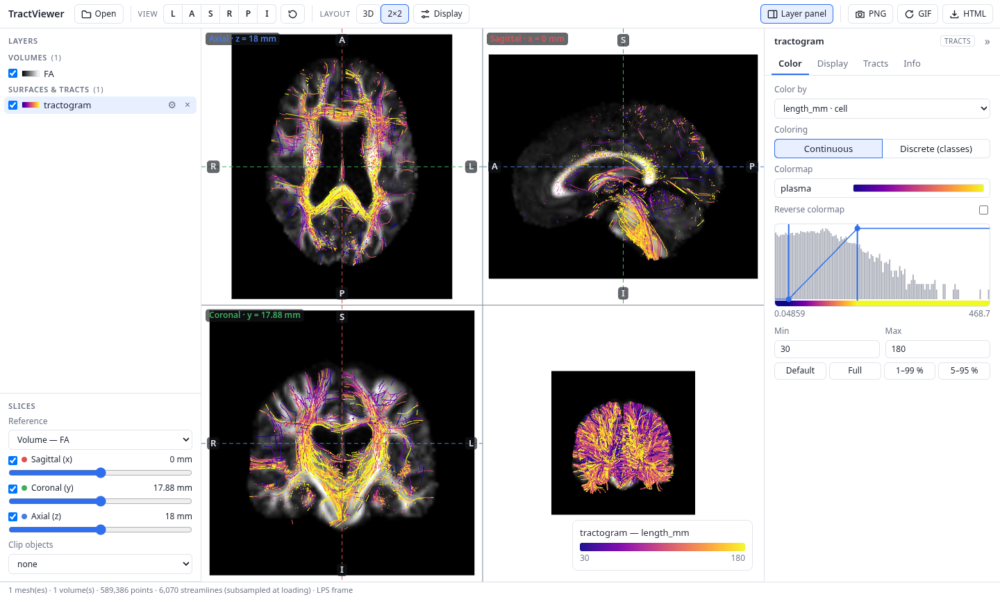
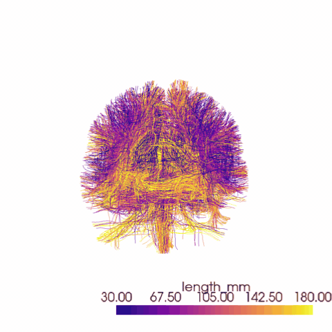

# TractViewer

Explore tractograms, surfaces and NIfTI volumes: color bundles by any of their arrays, slice
through anatomy, filter streamlines and export rotation GIFs, in a desktop app that needs no
Python, no browser and no network.



## Download the desktop app

Get the latest version from the [releases page](https://github.com/nathandecaux/TractViewer/releases/latest):

| System | File | Install |
|---|---|---|
| Windows 10/11 | `TractViewer-<version>-windows-x64-setup.exe` | run the installer (no admin rights needed) |
| macOS (Apple Silicon / Intel) | `TractViewer-<version>-macos-arm64.dmg` / `-macos-x86_64.dmg` | drag TractViewer to *Applications*, then the first time: right click › *Open* |
| Linux x86_64 | `TractViewer-<version>-linux-x86_64.AppImage` | `chmod +x` and run it: it offers to install itself and add a menu entry |

Open your files with the *Add files* button or by dropping them on the view. The app checks for
new releases at startup and updates itself in one click.

→ [Desktop app guide](docs/desktop.md): installation details, updates, uninstall, troubleshooting.<br>
→ [Interface guide](docs/interface.md): coloring, slices, 2D views, isosurfaces, clipping, GIF export, large tractograms.

Supported formats:
- tractography: `.tck`, `.trk`
- meshes: anything PyVista/VTK reads (`.vtk`, `.vtp`, ...)
- NIfTI: `.nii`, `.nii.gz`
- images: `.png`

## Other ways to use TractViewer

The Python package offers the same interface and more, for scripts, pipelines and servers:

```bash
pip install git+https://github.com/nathandecaux/TractViewer.git
```

| Use | Example | Documentation |
|---|---|---|
| **Command line**: inspect files, render PNG / MP4 / GIF headless | `tractviewer record bundle.tck -o rot.gif` | [docs/cli.md](docs/cli.md) |
| **Python API**: build scenes from scripts or notebooks | `vis = TractViewer(); vis.add("bundle.tck")` | [docs/python-api.md](docs/python-api.md) |
| **Remote web server**: run on a server, view in any browser | `tractviewer web --port 8080` | [docs/web-server.md](docs/web-server.md) |
| **Standalone HTML**: one shareable file, no server needed | `tractviewer html bundle.vtk -o scene.html` | [docs/web-server.md](docs/web-server.md#standalone-html-pages) |
| **Desktop window from Python** | `tractviewer desktop anat.nii.gz bundle.trk` | [docs/desktop.md](docs/desktop.md#from-the-python-package) |



## Documentation

- [Desktop app](docs/desktop.md)
- [Interface](docs/interface.md)
- [Command line](docs/cli.md)
- [Python API](docs/python-api.md)
- [Remote web server and HTML export](docs/web-server.md)
- [Development, releases and code layout](docs/development.md)
