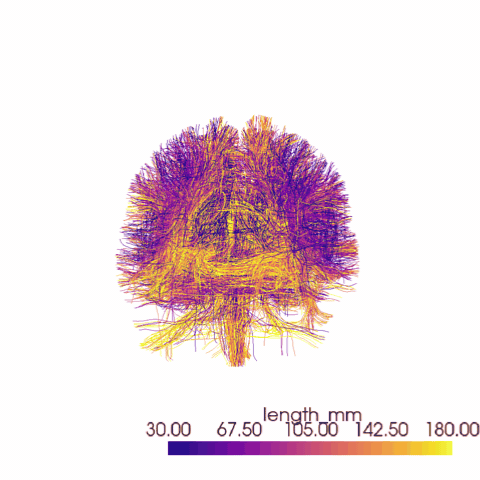

# Command line

Installed with the Python package:

```bash
pip install git+https://github.com/nathandecaux/TractViewer.git
```

```text
tractviewer desktop    [FILES...]            interface in a native window (see desktop.md)
tractviewer web        [FILES...]            interface served over HTTP (see web-server.md)
tractviewer html       FILES... -o x.html    standalone web page
tractviewer show       FILES...              interactive pyvista window
tractviewer screenshot FILES... -o x.png     PNG capture
tractviewer record     FILES... -o x.mp4     rotation video / GIF (format from the extension)
tractviewer info       FILES...              arrays and sizes of the datasets
tractviewer --version
```

`tractviewer COMMAND -h` lists the options of each command.

## Headless rendering

`screenshot` and `record` render with pyvista, without a window (off-screen mode is enabled
automatically when there is no `DISPLAY`).



```bash
tractviewer info bundle.vtk                                    # which arrays can be displayed
tractviewer screenshot bundle.tck --background black -o out.png
tractviewer record bundle.tck --frames 180 -o rot.mp4
tractviewer record bundle.tck --frames 120 --fps 15 -o rot.gif
tractviewer show anat.nii.gz:cmap=gray,opacity=0.3 bundle.trk
```

Installing `ffmpeg` is recommended for video export.

## Per-file parameters

Each file accepts parameters: `path:key=val,key=val`

```bash
tractviewer web \
  anat.nii.gz:display_array=intensity,cmap=gray,clim=(200,800),opacity=0.25 \
  bundle.tck:display_array=length_mm,cmap=plasma,line_width=2,threshold=(length_mm,50,200)
```

- bool: `true/false`, `yes/no`, `on/off`; a bare key means `true` (e.g. `contour`)
- `None`/`null`, `int`, `float`, tuples `(a,b,c)`
- `clim=(min,max)` or `clim=min:max`
- `threshold=(array,min,max)` or `threshold=array;min;max`
- cast of the displayed array: `type=int` or `type=float`

The keys are the [`add(...)` parameters](python-api.md#add-parameters) of the Python API. An
unknown key triggers a warning suggesting the closest valid key.

## Common options

- `--background`, `--window-size WxH`, `--color` (default color), `--ras-axes`
- NIfTI: `--no-marching-cubes`, `--smooth N` (default 200), `--iso V`, `--coord LPS|RAS`
  (`desktop`, `web` and `html` always load NIfTI files as slices unless a file sets
  `marching_cubes=true`)
- Tractograms: `--max-points N|auto` (see [Large tractograms](interface.md#large-tractograms))
- `desktop`: `--title`, `--max-streamlines`, `--max-voxels`, `--debug`, `--no-update-check`
- `web`: `--host`, `--port`, `--open`, `--title`, `--max-streamlines`, `--max-voxels`
- `html`: `--title`, `--max-streamlines`, `--max-voxels`
- `screenshot` / `record`: `--mesh-rotation X Y Z` (default `-90 0 0`)
- `screenshot`: `--transparent`
- `record`: `--frames`, `--step`, `--elevation`, `--fps`

## Environment variables

- `PYVISTA_OFF_SCREEN=1`: headless rendering
- `TRACTVIEWER_NIFTI_COORD=LPS|RAS`: default frame (default LPS; `coord_system=` takes precedence)
- `TRACTVIEWER_NIFTI_ISO=<value>`: default iso value (default 0.2; `iso_value=` / `iso=` take precedence)
- `TRACTVIEWER_MAX_POINTS=N|auto`: default point budget of tractograms (`max_points=` takes precedence)
- `TRACTVIEWER_DEBUG=0|1`: debug logs
- `TRACTVIEWER_NO_UPDATE=1`: pre-compiled app, no update check
- `TRACTVIEWER_NO_INTEGRATION=1`: Linux AppImage, never offer to install it

## Former syntax

The syntax without a subcommand still works but is deprecated:
`--interactive` → `show`, `--screenshot x.png` → `screenshot -o x.png`,
`--rotate N --rotation-output x.mp4` → `record --frames N -o x.mp4`, `--rotation-x/y/z` →
`--mesh-rotation X Y Z`, `--web --web-host --web-port --open-browser` → `web --host --port --open`.
