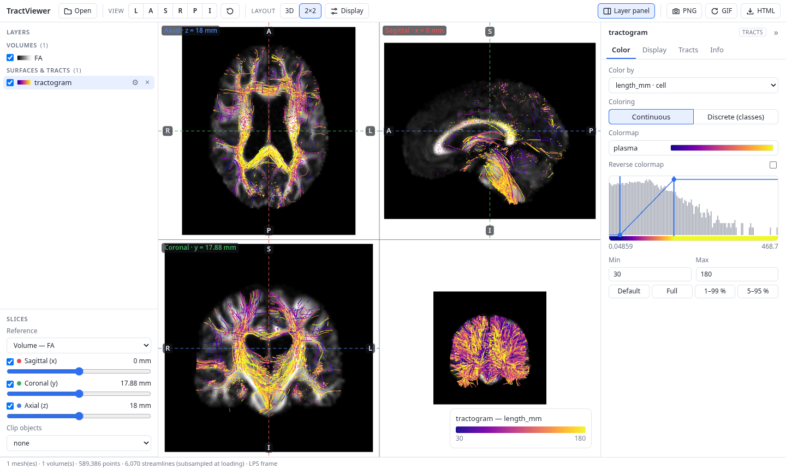

# Interface

The same interface is used by the [desktop app](desktop.md), the [web server](web-server.md)
and [standalone HTML pages](web-server.md#standalone-html-pages).

Rendering happens in the page (WebGL, [vtk.js](https://kitware.github.io/vtk-js/)). The geometry
and **all arrays** (point and cell data) are sent to the page, so exploring a bundle needs no round
trip to the server.

## Features

- **Objects**: pick the array to color by, the colormap, the range, a solid color, opacity, line
  width, representation; toggle visibility or remove an object. Vector arrays are colored by
  magnitude. Colormaps are sampled from matplotlib, so colors match the pyvista rendering.
- **Colormaps**: the picker shows a preview of each colormap. Common ones come first, more are
  in the *Extras* (sequential, diverging, cyclic), *Categorical* (tab10, Set1, Paired…) and
  *Custom* (per-file `cmap`) sub-menus. *Reverse colormap* flips it.
- **Discrete coloring** (meshes and volumes): switch *Coloring* to *Discrete* to color by classes.
  Each class has a color and a value range (*From* = *To* for a single value). Classes can be
  generated as one per distinct value (labels, up to 256), equal intervals over Min–Max, or
  quantiles, with colors from a categorical palette or any discretized colormap; then edit, add
  or remove them. Values outside every class use the *Other values* color. The *∅* (empty)
  toggle of a class, or of *Other values*, hides those values: mesh parts and voxels become
  invisible (e.g. hide the background label 0 of an atlas to see the objects behind the slices).
  The legend lists the classes; volume slices use nearest-neighbor interpolation so labels do not
  blend.
- **Add files** (desktop app and web server): use the button or drop files on the view; a loading
  indicator shows while the file is processed. Uploaded files go through the same loading as the
  CLI, including the projection of tractograms onto the affine of the first NIfTI.
- **Slices**: every NIfTI is also sent as a volume, resampled on the axes of the LPS/RAS frame.
  When a NIfTI is loaded it becomes the reference: sagittal, coronal and axial slices with
  colormap and windowing. Without a NIfTI, choose the reference (an object or the whole scene) and
  translucent cutting planes are drawn instead.
- **Isosurface**: NIfTI files are loaded as slices. Select a volume to generate its isosurface with
  marching cubes, choosing the iso value and the number of smoothing iterations (windowed sinc).
  It is computed in the page, so it also works in exported pages. To compute it in Python
  instead, pass `marching_cubes=true` (and `smooth`, `iso`) in the
  [file parameters](cli.md#per-file-parameters).
- **2D views** (default layout, *2×2* in the toolbar; *3D* for the 3D view alone): axial, sagittal
  and coronal views (radiological convention: patient right on the left) next to the 3D view. They
  show the slices of the reference volume and, optionally, the objects within a slab around each
  slice. For tractograms, only the streamline pieces crossing the slab are extracted (spatial index
  built on first use), so the 2D views cost little even for millions of points.
  - mouse wheel: move the slice of the view (Shift: 5 steps, Ctrl: zoom)
  - click / drag: move the cross (the two other slices)
  - right drag: zoom; Shift / middle drag: pan; double click: reset the view

  The cross and labels are drawn into PNG captures and GIFs.
- **Clipping**: cut the objects with the active planes, either as a slab of adjustable thickness
  or by keeping one side of each plane.
- **Rotation GIF**: full turn around the vertical axis of the current view, with frame count, FPS
  and width settings. Encoded in the page, so it also works in exported HTML pages.
- **Export to standalone HTML**: saves the current scene as a single HTML file: uploaded files,
  display settings, isosurfaces computed in the page, slices and camera. Like `tractviewer html`,
  the file loads vtk.js from a CDN.
- **View**: anatomical presets (left, right, anterior, posterior, superior, inferior), PNG capture,
  background color, **RAS axes**: an orientation marker that follows the camera, drag it anywhere
  in the view; it is drawn into PNG captures and GIFs (on by default with `--ras-axes`).

## Large tractograms

Large tractograms are **subsampled at loading by default** (like MI-Brain). The number of points
of a `.trk`/`.tck` is estimated from its header and size (without reading it) and compared with
what the available RAM affords: half of the available memory, ~250 bytes per point for Python +
page, at most 30 M points. Above it, streamlines are drawn at random (fixed seed) while the file
is read lazily, so the full tractogram is never in memory. The Tracts tab and the status bar say
when a tractogram was subsampled.

Override with `--max-points N` (`0` = no limit), per file `bundle.tck:max_points=N`, or the
`TRACTVIEWER_MAX_POINTS` environment variable.

In the desktop app and the web server, arrays are downloaded as raw binary (not base64 in the
page), so the browser's string length limit (~536 M characters, about 19 M points as base64) does
not apply. It still applies to standalone HTML pages (`html`, *Export*), which embed the scene: a
warning is shown above it.

Measured on synthetic tractograms (headless Chrome with software WebGL, so GPU buffers count in
RAM; 1 mm steps, ~60 points per streamline):

| Points | Load (page ready) | Browser peak | Python peak |
|---|---|---|---|
| 1 M | 1.0 s | 1.4 GB | 0.4 GB |
| 10 M | 3.0 s | 2.5 GB | 1.0 GB |
| 20 M | 6.9 s | 4.0 GB | 1.6 GB |
| 40 M | 10.7 s | 6.7 GB | 3.0 GB |

Other limits: `--max-streamlines N` subsamples tractograms when the page is built and
`--max-voxels N` decimates volumes (default 16e6). A 3.6M-voxel volume adds about 20 MB to the page.
